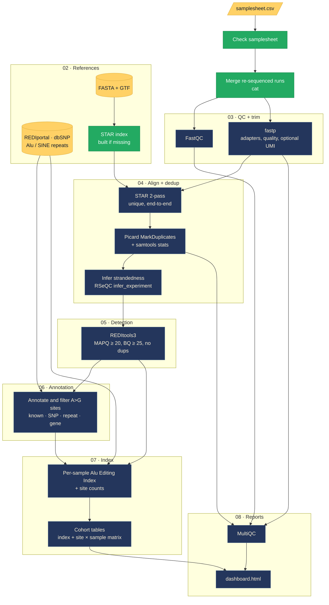

<p align="center">
  
</p>

<p align="center">
  <a href="https://www.nextflow.io/"></a>
  
  <a href="LICENSE.md"></a>
  
</p>

**ADARable** is a Nextflow pipeline for **A-to-I RNA editing**. It takes RNA-seq FASTQs, finds sites where ADAR enzymes turned adenosine into inosine (read by the sequencer as G), and reports per-sample and cohort editing levels, ending in an interactive dashboard.

> [!NOTE]
> Work in progress, built in phases. See [Roadmap](#roadmap) for what runs today.

## Workflow



<sub>Green = runs today · navy = planned · yellow = inputs and reference data.</sub>

## Quick start

Needs [Nextflow](https://www.nextflow.io/) ≥ 25.04 and Docker or Apptainer.

```bash
git clone https://github.com/bioinfo-fiend/adarable.git && cd adarable

# smoke test on bundled real reads (tiny chr22 slice)
nextflow run main.nf -profile test,docker

# your data
nextflow run main.nf -profile docker \
    --input samplesheet.csv \
    --genome GRCh38 \
    --outdir results
```

Use `-profile apptainer` on HPC, and `-resume` to reuse finished steps.

## References

Nothing is stored in this repo. `--genome GRCh38` or `--genome GRCm39` reads public copies straight from the cloud:

| | Source |
|---|---|
| Genome FASTA | [Broad public references](https://console.cloud.google.com/storage/browser/gcp-public-data--broad-references) (GENCODE primary assembly) |
| Annotation | [GENCODE](https://www.gencodegenes.org/) 50 (human), M39 (mouse) |
| SNPs | dbSNP 138 via Broad (human), Ensembl variation (mouse) |
| Repeats | [UCSC RepeatMasker](https://genome.ucsc.edu/) (Alu; mouse B1/B2) |
| Known editing sites | [REDIportal](http://srv00.recas.ba.infn.it/atlas/) (mouse lifted from mm10 to mm39) |

Prepared files (uncompressed FASTA, STAR index, repeat and known-site BEDs) are built once into `--ref_cache` (default `./ref_cache`) and reused on later runs. Point several projects at one shared `--ref_cache` to build them only once.

**Have your own references?** Copy [conf/local.example.config](conf/local.example.config) to `conf/local.config` (git-ignored), set your paths, and add `-c conf/local.config`. Anything you leave out falls back to the cloud copy. Single files can also be swapped with `--fasta`, `--gtf`, `--star_index`, `--dbsnp`, `--repeats`, `--rediportal`.

## Samplesheet

```csv
sample,fastq_1,fastq_2,strandedness
liver_1,data/liver_1_L001_R1.fastq.gz,data/liver_1_L001_R2.fastq.gz,auto
liver_1,data/liver_1_L002_R1.fastq.gz,data/liver_1_L002_R2.fastq.gz,auto
brain_1,data/brain_1_R1.fastq.gz,,reverse
```

- Repeated `sample` rows are re-sequenced runs and get merged.
- Leave `fastq_2` empty for single-end.
- `strandedness`: `auto`, `forward`, `reverse` or `unstranded`.
- Relative paths resolve against the samplesheet's folder.

## Outputs

```
results/
├── pipeline_info/   params, software versions, execution report, timeline, trace, DAG
├── samples/<id>/    trimmed-read QC, BAMs, strandedness, REDItools calls, annotated sites, editing index
├── cohort/          editing_index.tsv, sites_matrix.tsv.gz
├── multiqc/         multiqc_report.html
└── dashboard.html   interactive summary, opens offline
```

Provenance (parameters, tool versions, logs) is written next to the results, so every run can be traced.

## Roadmap

| Phase | What | Status |
|---|---|---|
| [00](docs/phases/00-overview.md) | Overview, samplesheet contract, design decisions | ✅ done |
| [01](docs/phases/01-skeleton.md) | Skeleton: config, profiles, samplesheet check, FASTQ merge, provenance | ✅ done |
| [02](docs/phases/02-references.md) | References for GRCh38 and GRCm39, STAR index, test slice | ✅ done |
| [03](docs/phases/03-qc-trim.md) | FastQC, fastp, MultiQC | 🚧 next |
| [04](docs/phases/04-align-dedup.md) | STAR 2-pass, MarkDuplicates, strandedness inference | ⏳ planned |
| [05](docs/phases/05-editing-detection.md) | REDItools3 site detection | ⏳ planned |
| [06](docs/phases/06-annotation.md) | Annotation against REDIportal, dbSNP, repeats | ⏳ planned |
| [07](docs/phases/07-editing-index.md) | Alu Editing Index and cohort tables | ⏳ planned |
| [08](docs/phases/08-dashboard.md) | Interactive results dashboard | ⏳ planned |

## Design choices

- **No BQSR.** Base-quality recalibration can treat real A>G editing as sequencing error. ADARable uses explicit filters instead: mapping quality, base quality, duplicates, read ends.
- **Swappable detector.** REDItools3 is the default. Any tool that writes the same table columns can replace it ([phase 05](docs/phases/05-editing-detection.md)).
- **Mouse support.** REDIportal's mouse sites are on mm10 and get lifted over to GRCm39 once. Mouse has no Alu repeats, so the editing index uses B1/B2 SINEs instead.
- **Static dashboard.** One HTML file, no server, archived with the results.

## Built on

[Nextflow](https://www.nextflow.io/) ·
[REDItools](https://github.com/BioinfoUNIBA/REDItools3) ·
[STAR](https://github.com/alexdobin/STAR) ·
[fastp](https://github.com/OpenGene/fastp) ·
[FastQC](https://www.bioinformatics.babraham.ac.uk/projects/fastqc/) ·
[Picard](https://broadinstitute.github.io/picard/) ·
[SAMtools](https://www.htslib.org/) ·
[RSeQC](https://rseqc.sourceforge.net/) ·
[MultiQC](https://multiqc.info/) ·
[REDIportal](http://srv00.recas.ba.infn.it/atlas/) ·
[dbSNP](https://www.ncbi.nlm.nih.gov/snp/) ·
[GENCODE](https://www.gencodegenes.org/)

Please cite these tools when you use ADARable. Each keeps its own license.

## License

[PolyForm Noncommercial 1.0.0](LICENSE.md): free for research, teaching, personal and other noncommercial use. Commercial use is not permitted.
